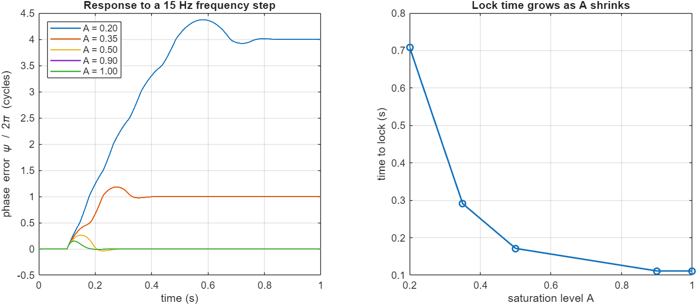
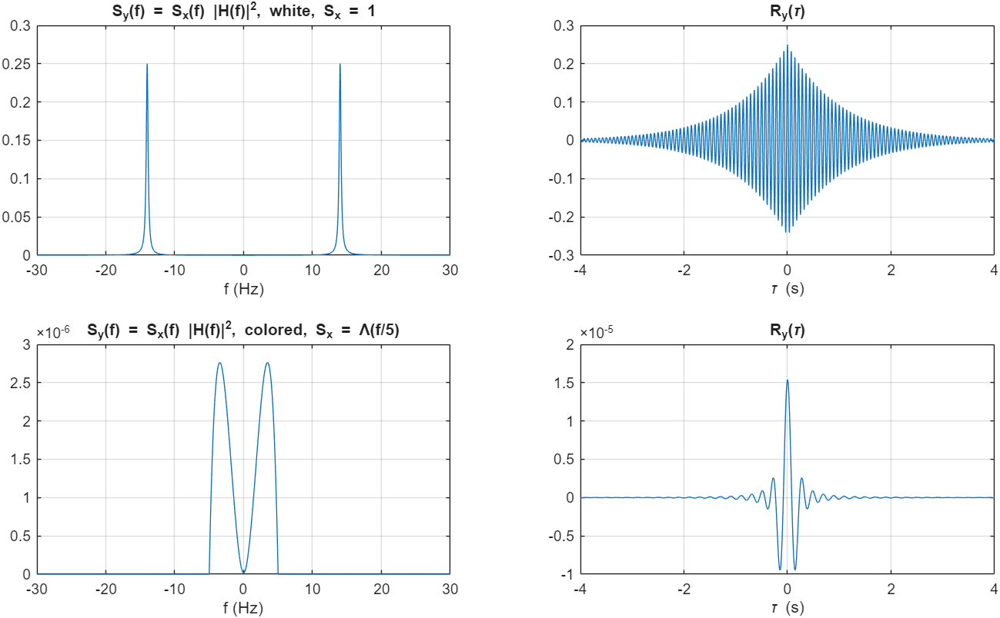
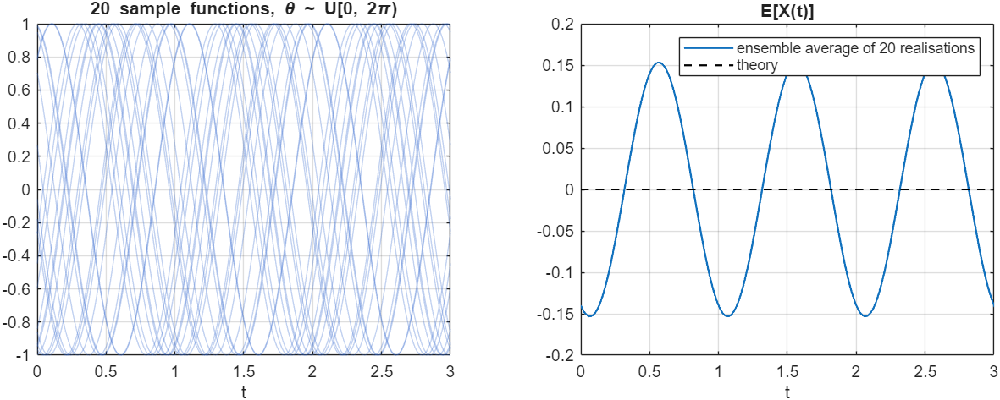
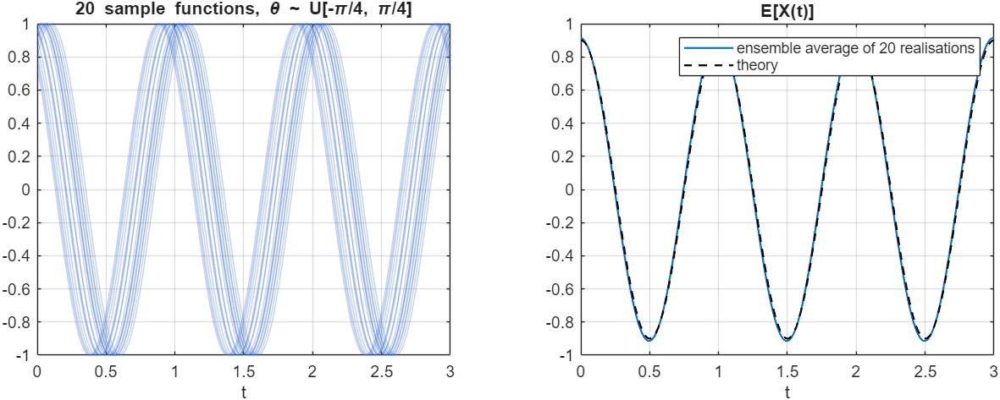

# Communication Systems in MATLAB, Homework 3: PLL Acquisition, Filtered Noise and Ergodicity

> **Course:** Communication Systems I, Amirkabir University of Technology, Fall 2024. Run `main` in MATLAB; figures go to `results/`.

## Q1. PLL with a limiting phase detector
The phase detector's output is sin ψ clipped to ±A. The loop is second order (ω_n = 2π·8 rad/s, ζ = 0.707), with a proportional-integral loop filter and an integrating VCO. It is driven by a 15 Hz frequency step.

| A | 0.2 | 0.35 | 0.5 | 0.9 | 1.0 |
|---|---:|---:|---:|---:|---:|
| Time to lock (\|ψ\| < 0.05 rad) | 0.71 s | 0.29 s | 0.17 s | 0.11 s | 0.11 s |

**Effect of A:**
- **Near lock** (|ψ| small, so sin ψ < A), the clip is inactive and the loop behaves identically for every A. The steady-state phase error is the same.
- **During acquisition** the clip limits the largest correction the loop can apply. With a small A, the loop *cycle-slips*: the phase error runs through full cycles before it pulls in (one slip at A = 0.35, four at A = 0.2), so acquisition takes much longer.
- **The limit.** If A is too small for the frequency offset, the loop cannot pull in at all. The pull-in range shrinks as A decreases.

## Q2. White and coloured noise through h(t) = e^{−t}cos(28πt)u(t)
$H(f)=\tfrac12\Big[\frac{1}{1+j2\pi(f-14)}+\frac{1}{1+j2\pi(f+14)}\Big]$ gives $S_y(f)=S_x(f)|H(f)|^2$ and $R_y(\tau)=\mathcal F^{-1}\{S_y\}$.

- **White input (S_x = 1).** S_y has two Lorentzian peaks at ±14 Hz. R_y(τ) is $\frac{e^{-|\tau|}}{4}\big[\cos\omega_0\tau+\frac{\cos\omega_0\tau-\omega_0\sin\omega_0|\tau|}{1+\omega_0^2}\big]$, and the numerical result matches this closed form to 10⁻⁴.
- **Coloured input (S_x = Λ(f/5)).** The input has no power above 5 Hz, so the 14 Hz resonance of the filter is never excited. The output spectrum is just the filter's low-frequency tail, and R_y becomes a slow, non-oscillating pulse.

## Q3. Is X(t) = A cos(2πf₀t + θ) ergodic?
Twenty realisations were generated for each phase distribution:

| θ distribution | Time averages ⟨X⟩, ⟨X²⟩ | Ensemble mean E[X(t)] | Conclusion |
|---|---|---|---|
| U[0, 2π) | 0, 0.5 | 0 for all t, E[X²] = A²/2 | Stationary and **ergodic** in mean and power |
| U[−π/4, π/4] | 0, 0.5 | $\frac{2\sqrt2}{\pi}A\cos(2\pi f_0t)$, which varies with time | **Not stationary**, so time and ensemble averages differ |

| θ ~ U[0, 2π) | θ ~ U[−π/4, π/4] |
|---|---|
|  |  |

## Changes compared with the original submission
- **Q1.** It iterated a fixed-point loop over the whole signal (`while s > 1e-5`), which is not a PLL simulation. The FM phase also lacked the 1/f_s factor. It is now a sample-by-sample second-order PLL, with lock time measured against A.
- **Q2.** |H|² came from an unscaled FFT, so it was off by 1/Δt², and R_y was not compared with theory. The exact H(f) and R_y(τ) are now used, and the FFT result is checked against them.
- **Q3.** "θ uniform on [−π/4, π/4]" was generated as `−π/4·rand + π/4·rand`, the difference of two uniforms. That has a triangular distribution, not a uniform one.

**Sepehr Ebrahimi**, B.Sc. Electrical Engineering, Amirkabir University of Technology (2026)
